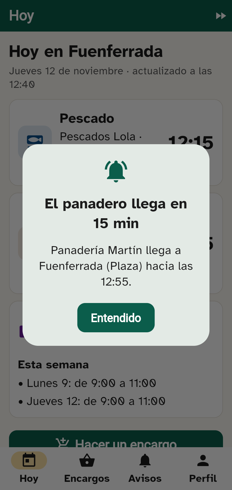
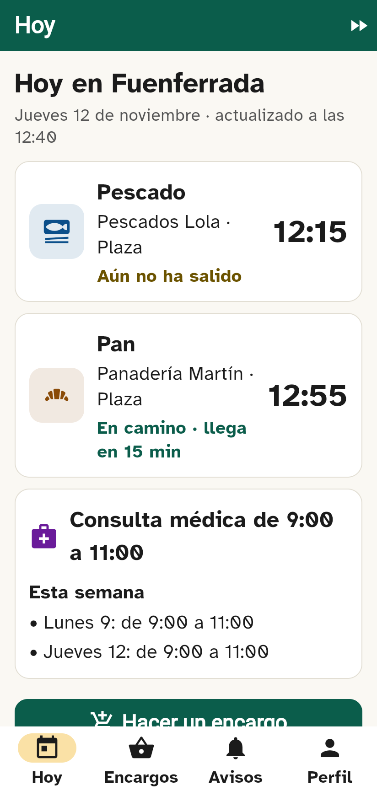
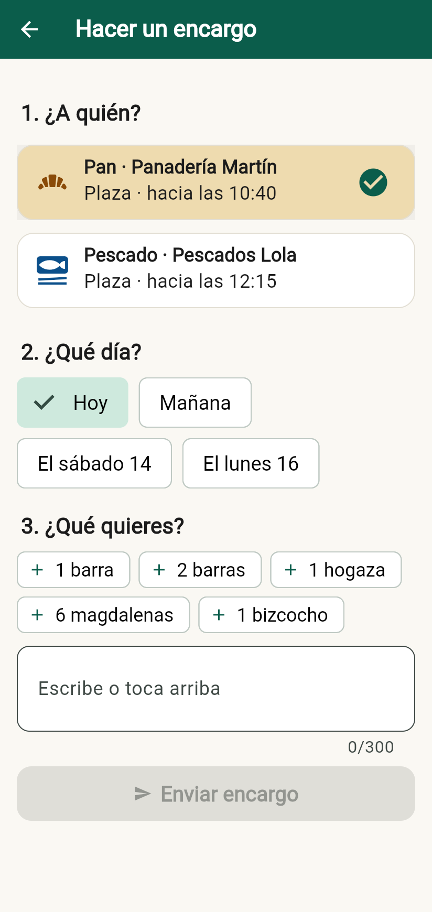
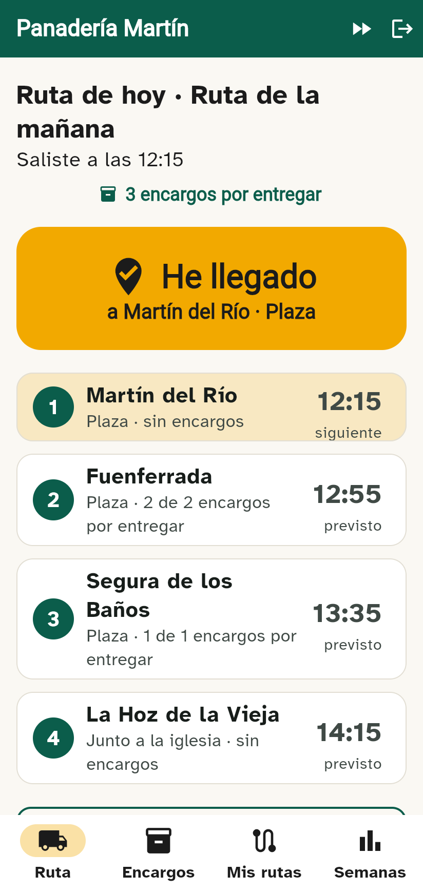
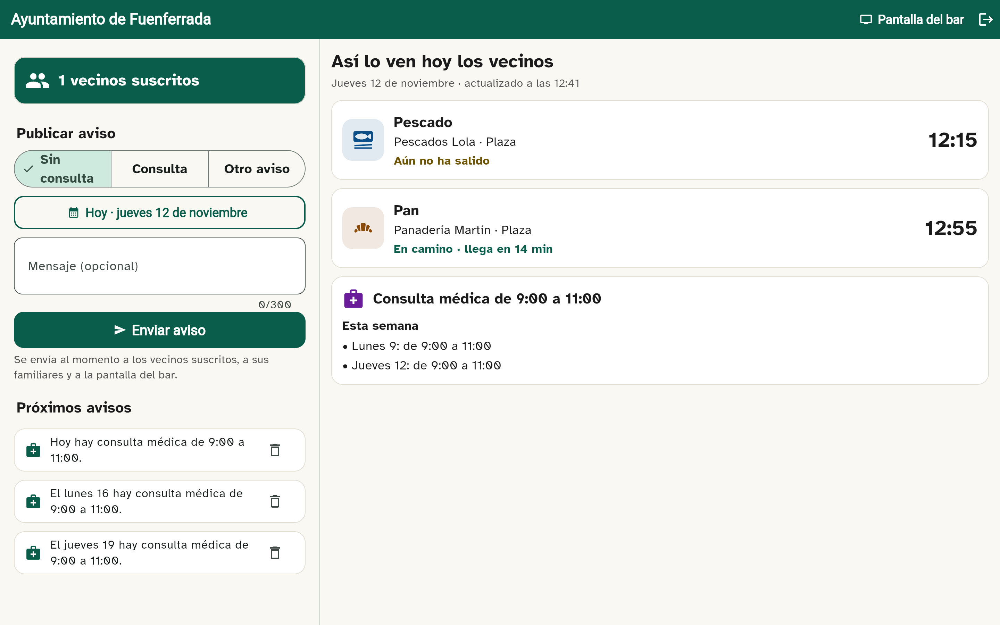
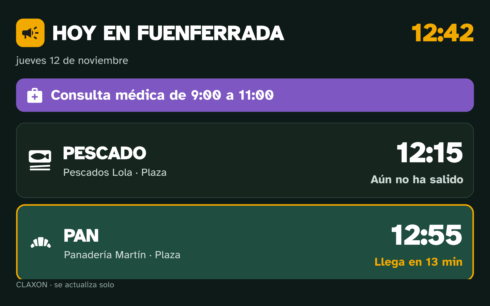

# CLAXON

**Te avisamos 15 minutos antes de que llegue el panadero, el pescadero o el médico.**

Proyecto final de 2.º DAM (Teruel, curso 2026-2027). CLAXON avisa a los vecinos de pueblos pequeños
de Teruel antes de que llegue cada vendedor ambulante, les deja hacer encargos y recibe al momento los
cambios de la consulta médica que publica el ayuntamiento.

| Usuario | Qué hace | Dónde |
|---|---|---|
| Vecina o vecino | Ve «Hoy en mi pueblo», recibe avisos y hace encargos | App (Android / web) |
| Familiar | Gestiona a distancia los avisos y encargos de su madre o padre | App |
| Vendedor | Inicia la ruta, pulsa «He llegado» y ve los encargos por parada | App |
| Ayuntamiento | Publica días de médico y cambios de última hora | Panel web |
| Bar del pueblo | Pantalla que se actualiza sola, sin iniciar sesión | Tablón web (tablet en modo quiosco) |

## Capturas

| Aviso | Hoy | Encargo | Vendedor |
|---|---|---|---|
|  |  |  |  |

| Panel del ayuntamiento | Tablón del bar |
|---|---|
|  |  |

---

## Probarlo en 1 minuto (sin Docker)

Necesitas **Java 21 o superior** y **Flutter 3.47.6 o superior** (Dart 3.13.5 o superior).
No hace falta instalar Maven: el repositorio trae el Maven Wrapper (`backend/mvnw`, `backend/mvnw.cmd`).

**En Windows**, lo más rápido es arrancar solo el servidor (lo que necesita la app del emulador).
Desde la carpeta del repositorio, en PowerShell:

```powershell
.\arrancar-servidor.cmd
```

El script busca solo el JDK (los que descarga IntelliJ en `%USERPROFILE%\.jdks`, los de
`Program Files` o el `java` del PATH), descarga Maven la primera vez y deja el servidor en
**http://localhost:8080** (desde el emulador de Android: `http://10.0.2.2:8080`).

Para tener también la web (app, panel y tablón) en el navegador:

```bash
# 1) Web (app, panel y tablón)
cd app
flutter pub get
flutter build web --release --no-web-resources-cdn

# 2) Servidor con base de datos H2 en memoria y datos de demostración
cd ../backend
./mvnw spring-boot:run      # en Windows: .\mvnw.cmd spring-boot:run
```

Abre **http://localhost:8080**. En la pantalla de inicio hay botones con las cuentas de prueba
(contraseña de todas: `claxon123`):

| Usuario | Rol |
|---|---|
| `carmen` | Vecina de Fuenferrada (código para la familia: 246810) |
| `antonio` | Vecino de Segura de los Baños |
| `lucia` | Hija de Carmen (modo familiar) |
| `pan.martin` | Panadería Martín: Martín del Río → Fuenferrada → Segura de los Baños → La Hoz de la Vieja |
| `pescados.lola` | Pescados Lola: Utrillas → Fuenferrada → Segura (martes, jueves y sábado) |
| `ayto.fuenferrada` | Ayuntamiento de Fuenferrada |
| `admin` | Administración (alta de vendedores y ayuntamientos) |

Tablón del bar de Fuenferrada: **http://localhost:8080/#/tablon/95** (o «Ver el tablón del bar» en el inicio).
Documentación de la API (Swagger): **http://localhost:8080/swagger-ui.html**.

### Guion de la demostración (para la defensa)

1. Entra como `pan.martin` y pulsa **Iniciar ruta**. Fuenferrada queda a 40 minutos.
2. Pulsa el icono ⏩ (arriba a la derecha, solo en modo demo) y adelanta el reloj del servidor 25 minutos.
3. Entra como `carmen` en otra ventana: aparece **«El panadero llega en 15 min»**. Pulsa «Entendido».
4. Entra como `lucia`: ve el mismo aviso y **«Lo vio a las…»** (HU9).
5. Vuelve a `pan.martin` y pulsa **He llegado** con retraso: Carmen recibe **«El panadero se retrasa»** (RF5).
6. Entra como `ayto.fuenferrada`, publica **Sin consulta** para hoy: llega al momento a Carmen y a Lucía,
   y el tablón del bar lo muestra en rojo.
7. Haz un encargo como `carmen` en tres toques y míralo en «Encargos» del panadero, agrupado por parada.

## Con Docker y MySQL (como en producción)

```bash
docker compose up --build
```

Levanta MySQL 8.4 y el servidor (que ya incluye la web) en http://localhost:8080. Con
`CLAXON_DEMO: "true"` en `docker-compose.yml` se crean los datos de demostración; ponlo a `false` en producción.

## App Android

```bash
cd app
flutter run                       # emulador: usa http://10.0.2.2:8080
flutter build apk --dart-define=API_URL=https://tu-servidor   # APK para el piloto
```

---

## Arquitectura

```
                 ┌──────────────────────────── Flutter (un solo proyecto) ─────────────────────────────┐
                 │  App vecino / familiar / vendedor   ·   Panel ayuntamiento   ·   Tablón del bar        │
                 │  shared_preferences: copia de «Hoy» y encargos + cola de encargos sin conexión        │
                 └───────────────────────────────────────┬───────────────────────────────────────────────┘
                                                         │ HTTPS · JSON · JWT
┌────────────────────────────────────────────────────────▼──────────────────────────────────────────────┐
│ Spring Boot 3.5 (Java 21)                                                                             │
│  controller/  REST por rol            security/  JWT + BCrypt + permisos por rol                       │
│  service/     EtaService (hora estimada) · NotificacionService · AvisoScheduler (cada minuto)         │
│  repository/  Spring Data JPA         config/   carga de los 236 municipios (INE) y datos demo         │
└───────────────┬──────────────────────────────────────────────────────────────┬─────────────────────────┘
                │ JPA                                                          │ firebase-admin
        MySQL 8.4 (Docker)                                          Firebase Cloud Messaging (opcional)
```

### Cómo se calcula la hora de llegada (RF11)

```
hora estimada = hora de salida + minutos hasta la parada + retraso medido
```

* La hora estimada **no se guarda**: se calcula siempre (`EtaService`).
* Al pulsar **He llegado**, el retraso pasa a ser `hora real − hora calculada` para esa parada y se aplica a
  las siguientes (si va adelantado, el retraso es negativo).
* Si el vendedor se queda sin red, se mantiene el último retraso y se sigue usando su horario.

### Cómo se mandan los avisos (RF4, RF5, RNF5)

`AvisoScheduler` llama cada minuto a `NotificacionService.revisarLlegadas()`, que para cada ruta en marcha y
cada parada pendiente busca los suscritos de ese pueblo y servicio:

* Si la llegada cae dentro de los próximos 15 minutos y aún no se avisó → **aviso**.
* Si ya se avisó y la llegada se ha retrasado **más de 5 minutos** respecto a lo avisado → **aviso corregido**.
* Cada aviso se guarda en la tabla `notificacion`, así **nunca se manda dos veces el mismo** y se puede saber
  si el vecino lo vio (HU9). Los familiares vinculados reciben una copia.

Los avisos del ayuntamiento se envían en el momento de publicarlos.

### Modelo de datos

Las 10 tablas de la propuesta (`usuario`, `vinculo_familiar`, `vendedor`, `ruta`, `parada`, `jornada`,
`suscripcion`, `encargo`, `pueblo`, `aviso`) más `notificacion`, el registro de avisos enviados.
Los 236 municipios de Teruel con su código INE y comarca se cargan de
`backend/src/main/resources/data/pueblos_teruel.csv` (datos abiertos del INE y de Aragón Open Data).

## Requisitos cubiertos

| Req. | Qué | Dónde |
|---|---|---|
| RF1 | Login por rol (JWT) | `AuthController`, `SecurityConfig`, `main.dart` |
| RF2 | Pueblo y suscripciones | Perfil del vecino, `SuscripcionService` |
| RF3 | Pantalla «Hoy» | `HoyService`, `hoy_view.dart` |
| RF4 | Aviso 15 min antes, una sola vez | `NotificacionService`, `AvisoScheduler` |
| RF5 | Aviso corregido si se retrasa > 5 min | `NotificacionService` |
| RF6 | Hacer, ver y cancelar encargos | `EncargoService`, `encargo_page.dart` |
| RF7 | «Iniciar ruta» con un botón | `VendedorService.iniciar`, `ruta_hoy_tab.dart` |
| RF8 | «He llegado» corrige las siguientes | `VendedorService.heLlegado`, `EtaService` |
| RF9 | Encargos por parada y entregados | `encargos_vendedor_tab.dart` |
| RF10 | Alta y edición de rutas | `ruta_editor_page.dart` |
| RF11 | Cálculo automático de la llegada | `EtaService` (con tests) |
| RF12 | Días de médico y cambios al momento | `AvisoService`, `panel_page.dart` |
| RF13 | Tablón del bar | `tablon_page.dart`, `/api/public/tablon/{id}` |
| RF14 | Modo familiar | `FamiliaService`, `familiar/` |
| RF15 | Sin conexión | Copia local + cola de encargos con `idCliente` (sin duplicados) |
| HU9 | «Vio el aviso» | `notificacion.vista_en` |
| HU10 | Encargos por semana | `semana_tab.dart` |
| RNF1 | Accesibilidad | Letra Atkinson Hyperlegible ≥ 18, botones ≥ 56, iconos con texto, etiquetas para TalkBack |
| RNF6 | Seguridad | BCrypt, JWT, permisos por rol, cada usuario solo ve lo suyo (probado en tests) |

## Tests

```bash
cd backend && ./mvnw test
```

17 pruebas: el cálculo de la hora estimada (`EtaServiceTest`) y un flujo completo de punta a punta con el
reloj fijado (`FlujoCompletoTest`): seguridad por roles, aviso a los 15 min y no antes, sin duplicados,
aviso corregido tras «He llegado», «sin consulta» del ayuntamiento, encargos (también sin conexión y desde el
familiar), entregas, estadísticas, edición de rutas y vinculación con código.

## Pendiente para el piloto

* **Notificaciones push con la app cerrada.** El servidor ya envía por FCM si se le da el fichero de la cuenta
  de servicio (`CLAXON_FCM_CREDENCIALES`). Falta crear el proyecto de Firebase, añadir
  `firebase_messaging` a la app con su `google-services.json` y mandar el token a `PUT /api/me/token-fcm`.
  Mientras tanto, la app consulta los avisos cada 20 segundos y los muestra en grande mientras está abierta.
* **Base de datos local con sqflite/drift** en Android (ahora se usa `shared_preferences`, que funciona igual
  en web y en móvil).
* Despliegue con HTTPS (por ejemplo, detrás de Caddy o Nginx) y cambiar `CLAXON_JWT_SECRETO`.
* Prueba guiada con personas mayores (RNF2) y ajustes de diseño en Figma.
